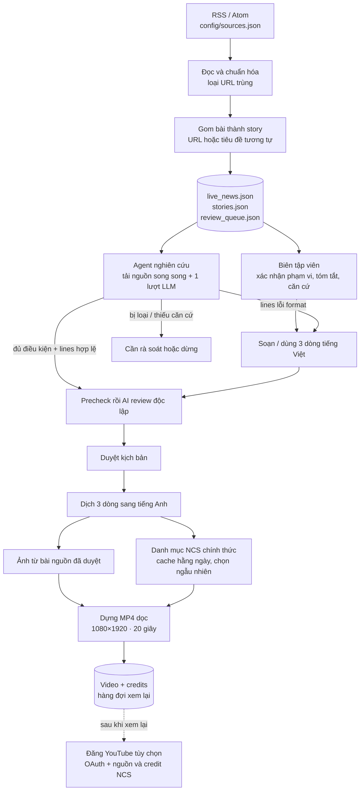

# Quy trình hoạt động của Agent Newsroom

> Tài liệu kiến trúc của prototype. Mô tả luồng xử lý và các thành phần trong mã nguồn, không phải hướng dẫn sử dụng.

Agent chuyển tin bóng đá từ RSS thành story có nguồn, kiểm tra phạm vi Ngoại hạng Anh, tạo nội dung ngắn, ghép ảnh và nhạc, dựng video dọc rồi chuẩn bị metadata để đăng. Quy trình có nhánh tự động và nhánh biên tập viên; cả hai dùng chung hàng đợi story và đầu ra video.

Sơ đồ SVG đầy đủ nằm trong [`prototype/agent_workflow.html`](prototype/agent_workflow.html).

## Sơ đồ luồng xử lý



Mũi tên liền biểu thị luồng dữ liệu chính. Mũi tên nét đứt là bước xuất bản tùy chọn sau khi video được xem lại.

## Hai nhánh xử lý story

### Nhánh có biên tập viên

Review UI hiển thị các story đã gom. Biên tập viên xác nhận story thuộc Ngoại hạng Anh, chọn trạng thái `supported` hoặc `uncertain`, sau đó cung cấp tóm tắt tiếng Việt và ghi chú căn cứ. API chỉ cho tạo video khi story có nguồn, đã được xác nhận và có nội dung được duyệt.

### Nhánh tự động

Newsroom agent tải các URL thuộc story trong allowlist host, trích nội dung rồi gửi các bài đã đọc trong một request LLM. Tối đa bốn URL được tải song song; tổng nội dung đưa vào ngữ cảnh bị giới hạn ở 24.000 ký tự. Nếu không đọc được nguồn nào, agent dừng trước khi gọi LLM. Nội dung bài được xem là dữ liệu không đáng tin cậy. Agent đối chiếu nguồn rồi phân loại story. Quyết định đã lưu của biên tập viên được ưu tiên dùng lại; story bị loại hoặc ngoài phạm vi không được chuyển tới bước dựng video.

## Các điểm kiểm soát nội dung

### Phạm vi và nguồn

- RSS tìm ứng viên; tên đội riêng lẻ không đủ để tự xác nhận tin thuộc Ngoại hạng Anh.
- Việc đọc bài chỉ dùng HTTPS, host trong allowlist và URL nguồn đã gắn với story.
- Khi chỉ có một nguồn hoặc các nguồn bất đồng, kết quả được hạ xuống `uncertain`.

### Nội dung video

- Nghiên cứu trả về ba dòng tiếng Việt. Nếu chúng qua precheck cấu trúc/chính sách, newsroom dùng lại và bỏ lượt gọi model viết riêng; nếu không, agent gọi writer fallback.
- Precheck xác nhận đúng ba dòng không rỗng, khác nhau, mỗi dòng tối đa 48 ký tự; story `uncertain` phải thể hiện rõ trạng thái chưa xác nhận. Reviewer LLM vẫn rà soát độc lập nội dung với tóm tắt và căn cứ; chỉ gọi writer sửa khi reviewer phát hiện lỗi, sau đó review lại.
- Nhánh biên tập viên cũng chạy precheck; nếu sai cấu trúc thì đánh dấu cần rà soát thay vì gọi reviewer LLM. Precheck không thay cho bước rà soát nội dung độc lập.
- Sau khi được chấp thuận, ba dòng được dịch sang tiếng Anh và in cố định lên video.
- Video dùng ảnh tĩnh có nhạc nền; hiện không có lời dẫn hoặc phụ đề đồng bộ theo thời gian.

### Ảnh và nhạc

- Ảnh được lấy từ bài của nguồn đã duyệt; redirect và host chứa media được kiểm tra.
- Danh mục nhạc NCS được nạp từ trang chính thức và cache một ngày. Track được chọn ngẫu nhiên, tránh phát lại track vừa dùng.
- Mẫu ghi công của track được thêm vào mô tả YouTube và file credits.

### Lỗi và vòng đời dữ liệu

- Lỗi RSS được ghi riêng; khi không nhận được bài mới, hàng đợi hiện có được giữ nguyên.
- Lỗi đọc nguồn hoặc LLM được lưu ở trạng thái cần rà soát hoặc lỗi.
- Video, ảnh và nhạc tải về quá hai giờ được dọn; manifest NCS và lựa chọn gần nhất được giữ lại.

## Thành phần trong mã nguồn

| Thành phần | Trách nhiệm |
| --- | --- |
| `prototype/config/sources.json` | Danh sách nguồn RSS và cấu hình nguồn được bật. |
| `prototype/cli.py` | CLI cho fetch, agent, chuẩn bị review, tạo draft và báo cáo hiệu năng. |
| `prototype/feed/rss_reader.py` | Đọc RSS/Atom và chuẩn hóa bản ghi tin. |
| `prototype/stories/clustering.py` | Gom các bài có cùng story theo URL hoặc tiêu đề tương tự. |
| `prototype/review/queue.py` | Tạo, cập nhật và lọc hàng đợi JSON. |
| `prototype/agent/newsroom.py` | Điều phối agent, đọc bài và đánh giá story. |
| `prototype/content/ai_writer.py` | Gọi Ollama để nghiên cứu, viết fallback, rà soát và dịch; kiểm tra định dạng ba dòng trước review. |
| `prototype/agent/media.py` | Tìm ảnh, nạp danh mục và tải track NCS. |
| `prototype/video/render.py` | Ghép ảnh, chữ và credits thành video dọc. |
| `prototype/video/retention.py` | Quản lý thời hạn lưu file media. |
| `prototype/performance.py` | Ghi stage/counter thành JSONL và tính thống kê thời gian. |
| `prototype/api/main.py` | Cung cấp API cho luồng biên tập và tạo video. |
| `prototype/review_ui/` | Giao diện React cho hàng đợi biên tập. |
| `prototype/publishing/youtube.py` | Xác thực OAuth và đăng video kèm nguồn, credit NCS. |
| `prototype/data/` | Trạng thái story, hàng đợi và dữ liệu runtime. |

Danh mục NCS và URL track được lấy từ website chính thức. Nếu cấu trúc website hoặc điều khoản thay đổi, parser hoặc khả năng sử dụng nhạc có thể cần cập nhật.

## Công nghệ, framework và cách triển khai

- **Backend:** Python; FastAPI và Pydantic cho REST API, Uvicorn để chạy server; HTTP dùng `httpx`, RSS/Atom được đọc bằng `urllib` và `xml.etree.ElementTree`.
- **Frontend:** React 18, React DOM và Vite 6 (`@vitejs/plugin-react`) cho giao diện hàng đợi biên tập.
- **AI:** Ollama qua HTTP `POST /api/chat`, model mặc định `qwen3:8b`, có thể đổi bằng `OLLAMA_BASE_URL` và `QWEN_MODEL`. Agent tải và trích bài trước rồi gửi nội dung trong một lượt nghiên cứu; mã hiện không dùng LLM tool-calling.
- **Media và xuất bản:** Pillow tạo ảnh card; FFmpeg mã hóa MP4; Google YouTube Data API client cùng OAuth 2.0 để đăng video. Ảnh, bài báo và danh mục nhạc tải qua HTTPS.
- **Lưu trữ:** JSON cho story/hàng đợi, JSONL cho telemetry; không có cơ sở dữ liệu. Một số kết quả tải về được cache trên file.

### Cách xử lý chính

- **Gom story:** URL giống nhau được nhóm trực tiếp; giữa các nhà xuất bản, tiêu đề được chuẩn hóa thành token rồi so bằng độ giao nhau token và `SequenceMatcher`. Ngưỡng tương đồng hiện tại là `0.74`.
- **Đọc nguồn an toàn:** chỉ đọc HTTPS từ host allowlist; URL trùng được loại, tối đa bốn bài tải song song và tổng phần văn bản bài nguồn đưa vào ngữ cảnh LLM bị giới hạn 24.000 ký tự. Không đọc được bài nào thì không gọi LLM nghiên cứu.
- **Kiểm soát script:** validator xác định kiểm tra ba dòng, độ dài, nội dung khác nhau và cách diễn đạt story `uncertain`; reviewer LLM vẫn kiểm tra nội dung độc lập.
- **Tác vụ đồng thời và đo đạc:** `ThreadPoolExecutor` giới hạn số tác vụ tải; telemetry theo stage lưu JSONL và báo cáo mean, p50, p95.

### Hàm và công cụ quan trọng

| Chặng | Hàm / công cụ |
| --- | --- |
| RSS và gom story | `fetch_sources`, `parse_feed`, `cluster_articles`, `title_similarity` |
| Nghiên cứu và script | `read_source_article`, `research_story`, `write_video_lines`, `validate_video_lines`, `review_video_text`, `translate_video_lines_en` |
| Ảnh, nhạc và video | `acquire_story_media`, `render_video`, Pillow, FFmpeg (`subprocess`) |
| API và xuất bản | FastAPI routes trong `prototype/api/main.py`, `upload_video`, Google YouTube Data API, OAuth 2.0 |
| Vận hành và telemetry | CLI `fetch`, `agent`, `perf`; `PerformanceRun`, `stage`, `summarize` |

**MCP:** hiện không có MCP server/client được tích hợp trong ứng dụng. Các tích hợp bên ngoài là HTTP tới Ollama, nguồn RSS/trang NCS, FFmpeg cài trên máy và YouTube API.

## Đo thời gian xử lý

Mỗi lượt chạy agent ghi một bản ghi JSONL vào `prototype/data/performance.jsonl`. Có thể giới hạn số story để đo một lượt ngắn:

```bash
python -m prototype agent --limit 1 --max-stories 1
python -m prototype perf --last 10
```

Telemetry lưu thời điểm bắt đầu/kết thúc, thời lượng và trạng thái của các stage; số request/tool LLM, thử viết lại, lỗi/timeout và cache hit/miss; cùng thời lượng mỗi story/video. Báo cáo tổng hợp mean, p50 và p95. Đặt `PERFORMANCE_LOG` để ghi sang đường dẫn khác. File log mặc định nằm trong `.gitignore` vì đây là dữ liệu runtime.

Để đo lại một story cụ thể, truyền `--story-id <id>`. Tùy chọn này chỉ đưa story đó vào lượt chạy và bỏ qua cooldown retry của nó; lượt chạy vẫn gọi nguồn RSS như bình thường.
