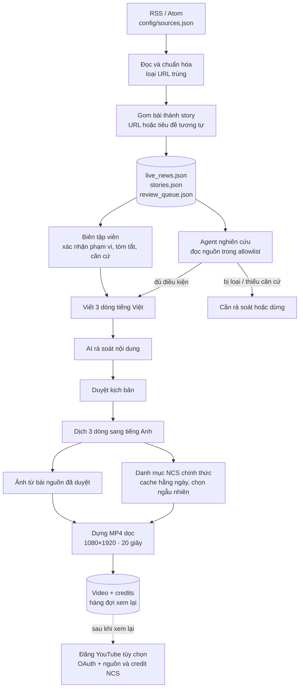

# Quy trình hoạt động của Agent Newsroom

> Tài liệu kiến trúc của prototype. Mô tả luồng xử lý và các thành phần trong mã nguồn, không phải hướng dẫn sử dụng.

Agent chuyển tin bóng đá từ RSS thành story có nguồn, kiểm tra phạm vi Ngoại hạng Anh, tạo nội dung ngắn, ghép ảnh và nhạc, dựng video dọc rồi chuẩn bị metadata để đăng. Quy trình có nhánh tự động và nhánh biên tập viên; cả hai dùng chung hàng đợi story và đầu ra video.

Sơ đồ SVG đầy đủ nằm trong [`prototype/agent_workflow.html`](prototype/agent_workflow.html).

## Sơ đồ luồng xử lý

Mũi tên liền biểu thị luồng dữ liệu chính. Mũi tên nét đứt là bước xuất bản tùy chọn sau khi video được xem lại.

## Hai nhánh xử lý story

### Nhánh có biên tập viên

Review UI hiển thị các story đã gom. Biên tập viên xác nhận story thuộc Ngoại hạng Anh, chọn trạng thái `supported` hoặc `uncertain`, sau đó cung cấp tóm tắt tiếng Việt và ghi chú căn cứ. API chỉ cho tạo video khi story có nguồn, đã được xác nhận và có nội dung được duyệt.

### Nhánh tự động

Newsroom agent đọc bài nguồn bằng công cụ giới hạn vào URL của story và các host đã cấu hình. Agent đối chiếu nguồn rồi phân loại story. Quyết định đã lưu của biên tập viên được ưu tiên dùng lại; story bị loại hoặc ngoài phạm vi không được chuyển tới bước dựng video.

## Các điểm kiểm soát nội dung

### Phạm vi và nguồn

- RSS tìm ứng viên; tên đội riêng lẻ không đủ để tự xác nhận tin thuộc Ngoại hạng Anh.
- Việc đọc bài chỉ dùng HTTPS, host trong allowlist và URL nguồn đã gắn với story.
- Khi chỉ có một nguồn hoặc các nguồn bất đồng, kết quả được hạ xuống `uncertain`.

### Nội dung video

- AI tạo ba dòng tiếng Việt, mỗi dòng tối đa 48 ký tự; lượt rà soát so nội dung với tóm tắt và ghi chú căn cứ.
- Sau khi được chấp thuận, ba dòng được dịch sang tiếng Anh và in cố định lên video.
- Video dùng ảnh tĩnh có nhạc nền; hiện không có lời dẫn hoặc phụ đề đồng bộ theo thời gian.

### Ảnh và nhạc

- Ảnh được lấy từ bài của nguồn đã duyệt; redirect và host chứa media được kiểm tra.
- Danh mục nhạc NCS được nạp từ trang chính thức và cache một ngày. Track được chọn ngẫu nhiên, tránh phát lại track vừa dùng.
- Mẫu ghi công của track được thêm vào mô tả YouTube và file credits.

### Lỗi và vòng đời dữ liệu

- Lỗi RSS được ghi riêng; khi không nhận được bài mới, hàng đợi hiện có được giữ nguyên.
- Lỗi đọc nguồn hoặc LLM được lưu ở trạng thái cần rà soát hoặc lỗi.
- Video, ảnh và nhạc tải về quá hai giờ được dọn; manifest NCS và lựa chọn gần nhất được giữ lại.

## Thành phần trong mã nguồn

| Thành phần | Trách nhiệm |
| --- | --- |
| `prototype/config/sources.json` | Danh sách nguồn RSS và cấu hình nguồn được bật. |
| `prototype/feed/rss_reader.py` | Đọc RSS/Atom và chuẩn hóa bản ghi tin. |
| `prototype/stories/clustering.py` | Gom các bài có cùng story theo URL hoặc tiêu đề tương tự. |
| `prototype/review/queue.py` | Tạo, cập nhật và lọc hàng đợi JSON. |
| `prototype/agent/newsroom.py` | Điều phối agent, đọc bài và đánh giá story. |
| `prototype/content/ai_writer.py` | Gọi Ollama để viết, rà soát và dịch nội dung. |
| `prototype/agent/media.py` | Tìm ảnh, nạp danh mục và tải track NCS. |
| `prototype/video/render.py` | Ghép ảnh, chữ và credits thành video dọc. |
| `prototype/video/retention.py` | Quản lý thời hạn lưu file media. |
| `prototype/api/main.py` | Cung cấp API cho luồng biên tập và tạo video. |
| `prototype/review_ui/` | Giao diện React cho hàng đợi biên tập. |
| `prototype/publishing/youtube.py` | Xác thực OAuth và đăng video kèm nguồn, credit NCS. |
| `prototype/data/` | Trạng thái story, hàng đợi và dữ liệu runtime. |

Danh mục NCS và URL track được lấy từ website chính thức. Nếu cấu trúc website hoặc điều khoản thay đổi, parser hoặc khả năng sử dụng nhạc có thể cần cập nhật.
